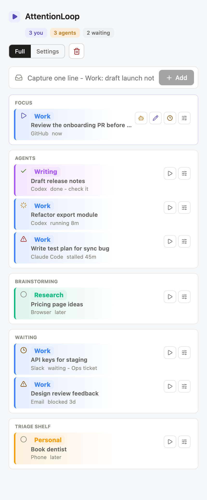

# AttentionLoop

**An always-on-top attention queue for one person working alongside several AI agents.**

| | |
| --- | --- |
| **Problem** | AI coding agents can run five threads at once, but the person directing them can only think about one. Work goes stale quietly: an agent finishes and nobody checks it, an agent stalls, a reply you were waiting on never arrives. To-do apps are too heavy for this, and chat tabs don't show it at all. |
| **Approach** | Model attention, not tasks. Each thread is owned by *you*, *an agent*, or *someone you're waiting on*. Only one thread can hold your focus. Capture takes one line, and a small pure function flags anything that has gone quiet too long. |
| **What it is** | A local-first React app that runs in the browser or as a small floating Electron window that stays on top of your editor. There's no backend and no account. |
| **Status** | Working MVP that I use day to day. MIT licensed. |

<p></p>

## The problem

When I started running several AI agents in parallel (Codex, Claude Code,
browser research), my bottleneck stopped being typing and became attention.
The failures were small and constant: a finished agent run sat unreviewed for
an hour, a stalled one looked "busy", and a question I was waiting on fell
out of view. Full task managers wanted projects, due dates and priorities. I
needed a glanceable answer to five questions: *What owns my attention right
now? What's running without me? What's waiting on someone else? What idea
shouldn't get lost? What can I safely park?*

## How I approached it

- **Lanes come from status, not from filing.** A thread's status (`now`,
  `running`, `done`, `waiting`, `later`) decides its lane: Focus, Agents,
  Brainstorming, Waiting or Triage. You never drag cards into folders.
- **One focus, enforced.** The Focus lane holds a single thread. Starting
  something else means deciding where the current one goes.
- **One-line capture.** `Work: draft launch notes in Codex` is parsed into
  project, title and location with fuzzy project matching. Everything stays
  editable inline.
- **An anti-stale engine as a pure function.** `flagOf(thread)` marks agent
  runs that have been quiet for 30+ minutes as *stalled*, finished runs as
  *check it*, and waits older than two days as *overdue*. Parked items left
  untouched for a week get a one-tap sweep, so the shelf never turns into a
  guilt pile.
- **Stay small and local.** It's a floating 430px window with keyboard
  shortcuts to hide and refocus it. Data lives in a git-ignored JSON file (or
  `localStorage` in the browser). There is no server to run or trust.

**Stack:** React 19, TypeScript, Vite, Electron, lucide icons.

---

## Features

- One-line capture for loose work threads.
- A single focus lane for the task that owns your attention now.
- Agent, brainstorming, waiting, and triage lanes for everything else.
- Inline editing for task title, project, location, status, waiting reason, and notes.
- Quick-add projects and locations directly from the task editor.
- Always-on-top desktop window for Windows/macOS/Linux through Electron.
- Local-first storage with no hosted backend.
- Desktop file storage in `.attention-loop/deck.json`, ignored by git.
- Browser fallback storage with `localStorage`.

## Quick Start

```bash
npm install
npm run desktop
```

That starts the local Vite app and opens AttentionLoop as a floating desktop window.

Keyboard shortcuts while the desktop app is running:

- `Ctrl+Alt+D`: hide or show the floating window.
- `Ctrl+Alt+F`: bring the floating window back into focus.

## Web Development

```bash
npm install
npm run dev
```

Open the local URL printed by Vite, usually `http://127.0.0.1:5174/`.

## Build

```bash
npm run build
```

This verifies the TypeScript and Vite production build. The current desktop script is a development wrapper around the local app, not a packaged installer.

To create a pin-friendly Windows desktop app:

```bash
npm run build:desktop
```

The executable is written to:

```text
release/AttentionLoop-win32-x64/AttentionLoop.exe
```

Pin that executable, not `electron.exe`.

## How to Use It

Capture one line:

```text
Work: draft launch notes in Codex
```

AttentionLoop will infer the project, task, lane, and location when it can. You can always edit everything inline.

Suggested flow:

1. Pick one task as Focus.
2. Work it until your human attention is no longer needed.
3. Send it to Agents, Brainstorming, Waiting, or Triage.
4. Choose the next Focus.

## Data and Privacy

AttentionLoop is local-first.

- The browser app stores data in browser `localStorage`.
- The desktop app stores data in `.attention-loop/deck.json` inside the project folder.
- `.attention-loop/` is gitignored so your personal task data is not committed.
- There is no remote database or hosted service.

## Project Structure

```text
desktop/      Electron wrapper for the always-on-top window
docs/         Product notes
src/          React app
```

## License

MIT
